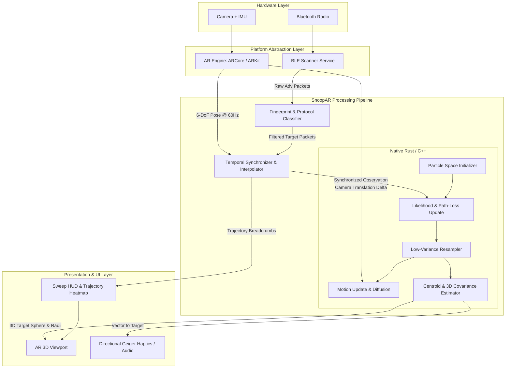
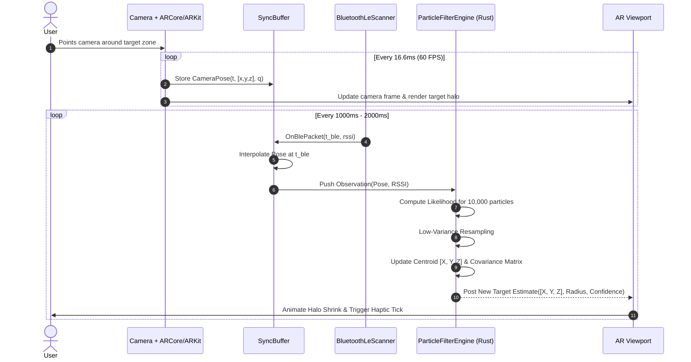
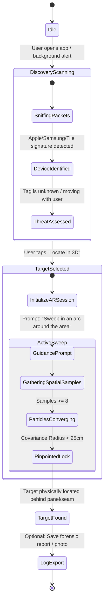

# 🏗️ SnoopAR: System Architecture Specification

This document details the modular software architecture, data pipelines, thread boundaries, and component interfaces of **SnoopAR**.

---

## 1. High-Level Architecture Diagram



---

## 2. Component Breakdown

### 2.1 BLE Scanner Service (`ScannerLayer`)
* **Role:** Interfaces directly with the OS Bluetooth stack in low-latency continuous scan mode.
* **Outputs:** Asynchronous stream of `RawBlePacket`:
  ```rust
  pub struct RawBlePacket {
      pub timestamp_ns: u64,
      pub device_id: String,          // Hardware MAC or iOS NSUUID
      pub rssi: i8,                   // -100 to 0 dBm
      pub tx_power: Option<i8>,       // Calibrated 0m/1m TxPower if broadcasted
      pub manufacturer_data: Vec<u8>, // Raw manufacturer TLV payload
      pub service_uuids: Vec<String>, // Advertised 16-bit / 128-bit UUIDs
  }
  ```

### 2.2 Fingerprint & Protocol Classifier (`ClassifierLayer`)
* **Role:** Parses raw advertising byte signatures, rejects benign devices (e.g., smart light bulbs, televisions, smartwatches), and fingerprints the tracking protocol.
* **Recognized Signatures:**
  * **Apple Find My Network:** Company ID `0x004c`, manufacturer type `0x12` (Find My payload, 25-byte payload). Offline finding bitflags extracted from status byte. (AirTag 1st & 2nd gen, third-party Find My tags). Note: separated AirTags retain rolling address for ~24 hours.
  * **Samsung SmartThings Find:** Service UUID `0xFD5A` and Company ID `0x0075` identifying Galaxy SmartTag / SmartTag2.
  * **Google Find My Device Network (FMDN):** Service UUID `0xFE2C` (Fast Pair) and Eddystone `0xFEAA` (FMDN frame types `0x40` / `0x41`).
  * **Tile:** Company ID `0x01D3` and Service UUID `0xFEED`.
  * **DULT (Detecting Unwanted Location Trackers):** Conforms to the Apple/Google joint standard for cross-platform tracker discovery and alerting.
  * **Generic Suspicious Periodic Beacon:** Any unclassified transmitter with an advertising period between 100 ms and 2500 ms observed continuously over $> 60 \text{ seconds}$.

### 2.3 Visual-Inertial Odometry Engine (`PoseTrackerLayer`)
* **Role:** Runs the platform's native SLAM/VIO engine (ARCore on Android, ARKit on iOS).
* **Outputs:** 6-DoF device pose at 60 Hz:
  ```rust
  pub struct CameraPose {
      pub timestamp_ns: u64,
      pub position: [f32; 3],    // [x, y, z] in metric camera world space
      pub orientation: [f32; 4], // [qw, qx, qy, qz] rotation quaternion
      pub tracking_state: TrackingState, // NORMAL, LIMITED, LOST
  }
  ```

### 2.4 Temporal Synchronizer (`SyncBuffer`)
* **Role:** Matches the Bluetooth packet arrival timestamp with the AR camera motion history.
* **Mechanism:** Maintains a ring buffer of recent `CameraPose` frames. When a `RawBlePacket` arrives at timestamp $T_{\text{ble}}$, it queries the buffer and performs linear interpolation (SLERP for quaternions, LERP for translation) to compute the exact camera 3D coordinate $[x, y, z]_{\text{ble}}$.

### 2.5 Core Localization Engine (`BayesianGridEngine`)
* **Role:** Computes the 3D spatial probability density of the target using a Coarse-to-Fine Bayesian Voxel Grid with analytically marginalized reference power $A$ and heavy-tailed Student-t likelihood.
* **Implementation:** Written in portable, zero-dependency **C++20** with a pure C-ABI for seamless interop across Android (JNI), iOS (Swift), and Python (`ctypes`).
* **Workflow:**
  * **Stage 1 (Coarse Sector):** Global search grid (0.2m voxel resolution) identifies the quadrant ($1.5 - 2.5\text{ m}$ sweep).
  * **Stage 2 (Close Sweep):** Refined local voxel grid (0.05m resolution) guided by near-field steep RSSI gradients ($30 - 50\text{ cm}$ sweep).
* **State & Likelihood:**
  $A$ is integrated out analytically or conditioned on known device priors (e.g. AirTag $\sim -58.5\text{ dBm}$ @ 1m), preventing parameter trade-off between transmit power and distance. Body blocking is modeled via the camera optical axis vector.

### 2.6 AR Overlay & Spatial Rendering Engine
* **Role:** Renders interactive holograms directly into the real-world camera stream.
* **Visual Elements:**
  * **Trajectory Breadcrumbs:** Floating 3D spheres showing where the user has walked, colored from cool blue (weak signal) to fiery red (peak signal).
  * **Target Halo:** A pulsing volumetric 3D spherical mesh anchored at the estimated centroid $[\bar{x}, \bar{y}, \bar{z}]$.
  * **Confidence Sphere:** The outer radius of the halo reflects the $3\sigma$ covariance error. As the filter converges, the halo physically contracts from a 1.5-meter cloud to a tight 20 cm sphere.
  * **Off-Screen Directional Pointer:** An arrow circling the camera edge pointing toward the target if it lies outside the current camera field-of-view.

---

## 3. Data Pipeline & Timing Lifecycle



---

## 4. Threading & Concurrency Model

To ensure a smooth, judder-free 60 FPS (or 120 FPS on ProMotion displays) augmented reality experience, compute tasks are strictly isolated across three distinct threads:

| Thread Name | Priority | Responsibilities | Max Budget |
| :--- | :--- | :--- | :--- |
| **AR Render Thread** | Real-Time / UI | Camera frame capture, OpenGL/Metal draw calls, matrix transforms, particle visualization | $< 16 \text{ ms}$ per frame |
| **BLE Event Thread** | Normal Background | OS Bluetooth callback handling, byte parsing, fingerprint classification | $< 2 \text{ ms}$ per packet |
| **Filter Compute Thread** | High Worker | Synchronized pose interpolation, 10,000-particle likelihood calculations, systematic resampling, 3×3 matrix inversions | $< 15 \text{ ms}$ per burst |

Communication between threads uses **lock-free single-producer single-consumer (SPSC) ring buffers**, eliminating UI thread lock contention.

---

## 5. Application States & User Journey


