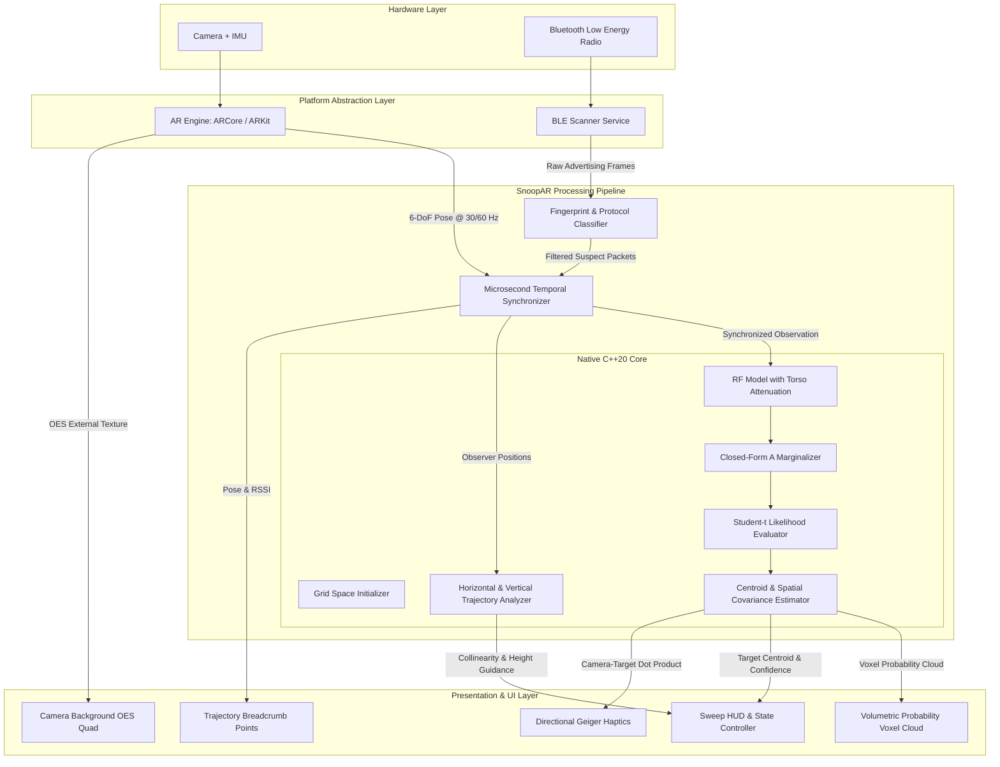
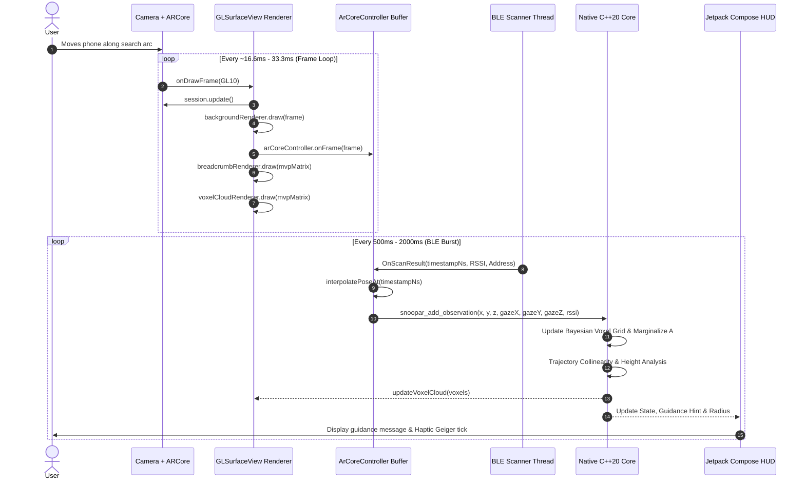
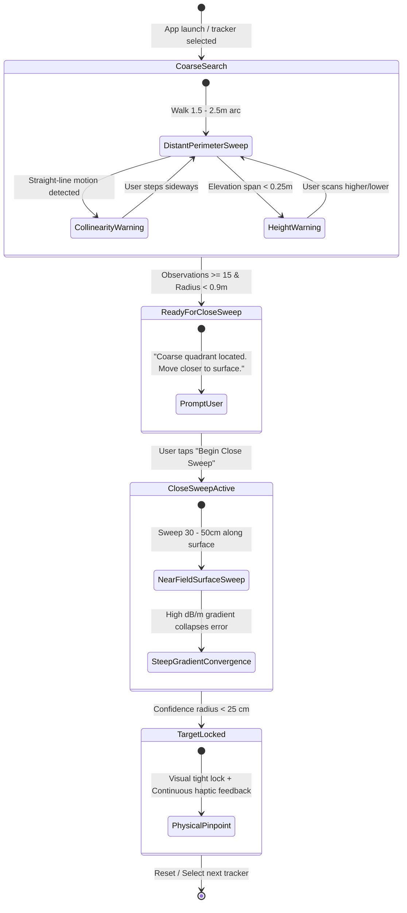

# SnoopAR: System Architecture Specification

This document details the software architecture, data pipelines, thread boundaries, and component interfaces of **SnoopAR**.

---

## 1. High-Level Architecture Diagram



---

## 2. Component Breakdown

### 2.1 BLE Scanner Service (`TrackerScanner`)
* **Role:** Interfaces directly with the operating system Bluetooth stack in low-latency continuous scan mode (`SCAN_MODE_LOW_LATENCY`, report delay = 0).
* **Outputs:** Asynchronous stream of raw advertisement events with hardware timestamps:
  ```kotlin
  data class BleScanEvent(
      val timestampNs: Long,       // SystemClock.elapsedRealtimeNanos()
      val deviceId: String,        // Hardware MAC or ephemeral UUID
      val rssi: Int,               // -100 to 0 dBm
      val rawBytes: ByteArray      // Raw payload bytes
  )
  ```

### 2.2 Fingerprint & Protocol Classifier
* **Role:** Parses advertising byte signatures, rejects benign devices (e.g., audio headphones, light bulbs, smartwatches), and fingerprints the tracking protocol.
* **Strict Filter Signatures:**
  * **Apple Find My Network:** Company ID `0x004c`, manufacturer type `0x12`, payload length $\ge 25\text{ bytes}$.
  * **Samsung SmartThings Find:** Service UUID `0000FD5A-0000-1000-8000-00805F9B34FB` (Galaxy SmartTag / SmartTag2).
  * **Google Find My Device Network (FMDN):** Service UUID `0000FEAA-0000-1000-8000-00805F9B34FB` with frame type `0x40` or `0x41`.
  * **Tile:** Service UUID `0000FEED-0000-1000-8000-00805F9B34FB` or `0000FEEC-0000-1000-8000-00805F9B34FB`, or Company ID `0x01D3`.
  * **Generic Suspicious Periodic Beacon:** Any unclassified transmitter with an advertising period between 100 ms and 2500 ms observed continuously.

### 2.3 Visual-Inertial Odometry Engine (`ArCoreController`)
* **Role:** Runs the platform's native SLAM/VIO engine (ARCore on Android, ARKit on iOS).
* **Outputs:** 6-DoF device pose at 30/60 Hz in standardized ARCore Y-up metric coordinates:
  ```kotlin
  data class CameraPoseSample(
      val timestampNs: Long,
      val x: Float, val y: Float, val z: Float,
      val gazeX: Float, val gazeY: Float, val gazeZ: Float
  )
  ```

### 2.4 Microsecond Temporal Synchronizer
* **Role:** Matches the Bluetooth packet arrival timestamp with the camera motion history.
* **Mechanism:** Maintains a concurrent ring buffer of recent camera poses covering 2.0 seconds of history. When a BLE packet arrives at hardware timestamp $T_{\text{ble}}$, it queries the buffer and performs linear interpolation (LERP) between adjacent camera samples to produce the exact 3D camera coordinate and gaze vector at the moment of packet reception.

### 2.5 Native Core Localization Engine (`snoopar_core`)
* **Role:** Computes the 3D spatial probability density of the target using a Hierarchical Bayesian Occupancy Voxel Grid with closed-form marginalized transmit power $A$, Student-t likelihood, and trajectory collinearity detection.
* **Implementation:** Zero-dependency, portable standard **C++20** with an `extern "C"` C-ABI:
  * `snoopar_create_engine(int32_t tracker_type)`
  * `snoopar_destroy_engine(SnoopAREngineHandle handle)`
  * `snoopar_reset_engine(SnoopAREngineHandle handle)`
  * `snoopar_set_tracker_type(SnoopAREngineHandle handle, int32_t tracker_type)`
  * `snoopar_add_observation(handle, obs_x, obs_y, obs_z, gaze_x, gaze_y, gaze_z, rssi, timestamp_ns)`
  * `snoopar_get_search_state(handle)`
  * `snoopar_get_guidance_hint(handle)`
  * `snoopar_start_close_sweep(handle)`
  * `snoopar_get_estimate(handle, &x, &y, &z, &radius)`
  * `snoopar_get_voxel_cloud(handle, voxels_out, max_count)`

### 2.6 AR Rendering Engine (`ArGlRenderer`)
* **Role:** Renders the camera video feed and 3D volumetric holograms into the GLSurfaceView.
* **Render Pipeline Passes:**
  1. **Camera Background Pass (`BackgroundRenderer`):** Fullscreen quad sampling `GL_TEXTURE_EXTERNAL_OES` with ARCore display-transformed UV coordinates. Depth test and depth write disabled.
  2. **Trajectory Breadcrumb Pass (`BreadcrumbRenderer`):** Floating 3D point sprites rendered with alpha blending, color-mapped from blue ($-85\text{ dBm}$) to red ($-55\text{ dBm}$).
  3. **Volumetric Voxel Pass (`VoxelCloudRenderer`):** Additive blending (`GL_SRC_ALPHA`, `GL_ONE`) point sprites with quadratic radial falloff, rendering a thermal glowing volumetric cloud over high-probability regions.

---

## 3. Data Pipeline & Timing Lifecycle



---

## 4. Threading & Concurrency Model

Compute and rendering tasks are separated across four isolated execution contexts:

| Thread | Priority | Responsibilities | Max Budget |
| :--- | :--- | :--- | :--- |
| **GL Render Thread** | Real-Time (Choreographer) | ARCore camera frame update, camera background OES quad draw, 3D point sprite draw calls | $< 16.6\text{ ms}$ (60 FPS) |
| **BLE Event Thread** | Background Handler | Bluetooth callback processing, byte signature classification, timestamp assignment | $< 2.0\text{ ms}$ per packet |
| **Core Compute Thread (JNI)** | Worker / Reactive | Camera pose interpolation, voxel grid log-likelihood evaluation, analytical $A$ update, trajectory SVD | $< 1.0\text{ ms}$ per observation |
| **UI Compose Thread** | Main UI | Jetpack Compose HUD overlay, target selector bottom sheet, stage indicator | Standard Android frame budget |

**Thread-Safety Guarantees:**
* `ArCoreController` uses a lock-free `ConcurrentLinkedDeque` for pose history.
* `BreadcrumbRenderer` snapshots direct vertex buffers inside a synchronized block before executing OpenGL draw calls.
* `VoxelCloudRenderer` builds native vertex buffers off-lock and performs atomic buffer swapping before GL draw execution.
* `TrackerScanner` emits new immutable `DiscoveredTracker` data instances so Jetpack Compose `StateFlow` detects changes without state mutation hazards.

---

## 5. Application Search States


